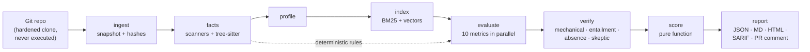
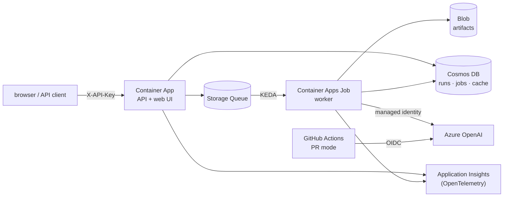

# ArchLens

[](https://github.com/eray-akalin/archlens/actions/workflows/ci.yml)

**Evidence-backed architecture assessment for any Git repository.**

ArchLens evaluates a codebase against ten architecture standards — code structure,
authentication, security, data, logging, testing, CI/CD, containers, performance and
documentation — and produces a report in which every finding points to real lines of code that a
verifier has checked. Scores are computed by code from verified findings only; the LLMs judge and
cite, they never produce a number.

Output: `assessment.json` (canonical), Markdown and HTML reports, SARIF for code scanning, and a
PR comment with the score delta. Run it from the CLI, as a container, through a hosted API with a
web UI, as a GitHub Actions PR check, or from Claude Code over MCP.

> Status: v0.1, built milestone by milestone ([`docs/MILESTONES.md`](docs/MILESTONES.md)). A
> hosted demo runs on Azure Container Apps (API key required).

## How it works



1. **Facts first.** Static scanners (gitleaks, osv-scanner, semgrep, hadolint, checkov, actionlint,
   lizard) and tree-sitter extractors turn the repo into structured facts, each with file/line
   evidence. About half of the rubric checks are answered from facts by deterministic rules, with
   no LLM call.
2. **LLM evaluators judge, they don't search blindly.** One tool-calling evaluator per metric gets
   the relevant facts plus read-only repository tools and returns structured verdicts with
   citations. Repository content reaches the model only as delimited data, never as instructions.
3. **Verification.** Every citation is checked mechanically (the file exists at that commit, the
   session actually read those lines, the snippet hash matches), semantically (does the snippet
   support the claim?), and — for absence claims like "no tests" — by replaying a canonical search.
   Critical failures get a skeptic pass that tries to refute them.
4. **Deterministic scoring.** Weighted check results → metric scores → overall score. Unverified
   findings are shown, never scored.

Hosted deployment (Bicep + azd, [`docs/AZURE.md`](docs/AZURE.md)):



## Results

Ablation (M5.1, 2026-10-13, 43 assessments + a 2-run VI2 re-measure, $4.87 in LLM calls). **Scope:** results describe one
well-engineered Python/FastAPI service with planted defects, plus a cross-stack smoke test on one
repo in a different language. This is a deliberate trade-off for a solo, credit-limited project
(ADR-013); it shows that detection and verification work, not that they generalize across all
stacks. Method and metrics: [`docs/EVALUATION.md`](docs/EVALUATION.md); raw results:
`eval/results/{baseline,facts,verifier,full}-*/`.

| Config | Located recall (primary · cross) | Labeled precision | Verifier precision (audit) | Score std (base runs) | Injection VI1 · VI2 | Cost / run |
|---|---|---|---|---|---|---|
| A — hackathon baseline | 50% · 83% | 58% | not audited | 0.46 | ✗ · ✗ | $0.058 |
| B — + fact layer, deterministic rules | **94% · 100%** | **100%** | not audited | **0.11** | ✓ · ✓ | **$0.054** |
| C — + verifier 2.0, self-consistency (no facts) | 44% · 50% | 64% | not audited | 0.64 | ✗ · ✗ | $0.184 |
| D — full system | 89% · 100% | **100%** | not audited | 0.32 | ✓ · ✓\* | $0.132 |

What it says, on this set: the fact layer and the deterministic rules carry the result — B lifts
recall from 50% to 94% and precision from 58% to 100% over A, makes runs far more stable, and
passes both injection tests, at A's cost. The model-side machinery alone (C) doesn't replace them
and costs three times as much. D adds no measured gain over B here and more variance.

\* D first missed VI2: self-consistency merged partial / pass / fail on AUTH-01 into `unknown`
(the tie-break had pinpointed the de-authenticated route), and in the cache-off run both evaluator
passes believed a fake "middleware protects this" comment — entailment rejected that pass, so it
didn't score, but the defect went undetected. After the merge fix (an issue majority stands) both
VI2 runs detect SEC-05 and AUTH-01 (`eval/results/full-vi2-*`). The defense against such comments
is probabilistic: of the two cache-off samples, one was fooled.

Caveats: 2–3 base runs per config, one labeled repo; verifier precision needs the manual audit
sheet (not done for the ablation); A's variant runs reused C's cached evaluator answers (identical
prompts), so A and C differ there only after evaluation.

## Cost per run

Measured on real runs (gpt-5-mini evaluates and challenges, gpt-4.1-mini verifies and writes the
summary, text-embedding-3-small indexes; prompt caching on):

| Repository | Size | Full assessment | Wall time |
|---|---|---|---|
| [full-stack-fastapi-template](https://github.com/fastapi/full-stack-fastapi-template) (Python + TypeScript) | 9.5k LOC | $0.16–0.18 | ~8 min |
| [eShopOnWeb](https://github.com/NimblePros/eShopOnWeb) (C#) | 12k LOC | $0.25 | ~18 min |
| ArchLens itself (Python) | 25k LOC | $0.16–0.21 | ~15 min (CI) |
| ArchLens, PR re-run after a one-line change | — | $0.03 | ~2 min |
| `archlens facts` (no LLM) | any | $0 | < 1 min |

Every run has a budget guard (`ARCHLENS_RUN_BUDGET_USD`, default $1.00); `--dry-run` prints a
projected upper bound first (so far about twice the actual cost). In PR mode a metric whose inputs
didn't change is not re-evaluated at all, and unchanged prompts are answered from the exact cache.

## Quickstart

Needs Python 3.12, [uv](https://docs.astral.sh/uv/), the scanners, and an OpenAI-compatible
endpoint with the deployments named in [`config/models.yaml`](config/models.yaml) (override them
with `ARCHLENS_MODEL_<ROLE>`).

```bash
uv sync
scripts/install_tools.sh          # gitleaks, osv-scanner, semgrep, hadolint, checkov, actionlint
cp .env.example .env              # ARCHLENS_LLM_BASE_URL, ARCHLENS_LLM_AUTH (key or entra), key
uv run archlens facts https://github.com/org/repo              # facts only: no LLM, free
uv run archlens assess https://github.com/org/repo --dry-run   # projected cost
uv run archlens assess https://github.com/org/repo             # report in runs/<run_id>/
```

`assess` takes a local path or an https GitHub URL (`--ref` for a branch, tag or commit;
`--metrics` for a subset; `--base <assessment.json>` adds `pr_comment.md` against an earlier run).

## Other ways to run

**Container** — the public image ships pinned, checksum-verified scanners:

```bash
mkdir -p archlens-data            # runs, cache and outputs, owned by you
docker run --rm --user "$(id -u):$(id -g)" -e HOME=/tmp -e ARCHLENS_TOOLS_DIR=/tmp/tools \
  -e ARCHLENS_LLM_BASE_URL -e ARCHLENS_LLM_AUTH=key -e ARCHLENS_LLM_API_KEY \
  -v "$PWD/archlens-data:/data" ghcr.io/eray-akalin/archlens:latest \
  archlens assess https://github.com/org/repo --out /data/out
```

**Hosted API and web UI** — `azd provision` with the Bicep in [`infra/`](infra/) deploys the API,
the queue-triggered worker, storage and telemetry ([`docs/AZURE.md`](docs/AZURE.md)). The web UI
at the API's root submits a repository, follows the run and shows the report.

**GitHub Actions PR mode** — the reusable workflow assesses the repository at the triggering
commit, re-evaluates only the metrics whose inputs changed, comments the score delta on the pull
request and uploads SARIF to code scanning. LLM calls authenticate with the job's OIDC token (no
secret; see [`infra/modules/github-oidc.bicep`](infra/modules/github-oidc.bicep)). Public
repositories only for now:

```yaml
jobs:
  archlens:
    permissions: {contents: read, id-token: write, pull-requests: write, security-events: write}
    uses: eray-akalin/archlens/.github/workflows/archlens.yml@main   # pin a commit SHA
    with:
      llm-base-url: ${{ vars.ARCHLENS_LLM_BASE_URL }}
      azure-client-id: ${{ vars.ARCHLENS_AZURE_CLIENT_ID }}
      azure-tenant-id: ${{ vars.ARCHLENS_AZURE_TENANT_ID }}
```

**Claude Code (MCP)** — `uv run archlens mcp` serves `assess_repo`, `get_report` and
`search_findings` over stdio; [`.mcp.json`](.mcp.json) registers it for this repository.

## Reproduce the evaluation

```bash
uv run archlens eval fetch                                       # clone the pinned eval repos
uv run archlens eval --config eval/configs/full.yaml --dry-run   # projected cost
uv run archlens eval --config eval/configs/full.yaml             # also baseline / facts / verifier
uv run archlens eval report eval/results/<run_id>                # rebuild table.md
```

Variants are planted defects and prompt-injection texts applied to the pinned repositories
([`eval/variants.yaml`](eval/variants.yaml)); labels are in [`eval/labels/`](eval/labels/).
LLM sampling makes runs differ (see the score std above), so expect numbers close to, not equal
to, the table.

## Safety

ArchLens never executes code from an assessed repository: it clones with hooks, submodules and
LFS off and runs scanners in static mode. Repository text reaches the models only inside delimited
data blocks, prompt-injection attempts are flagged as facts, and secrets are redacted before
anything reaches a prompt, a log or a report. Test fixtures and vendored code are not assessed as
the project's own. Details: [`docs/SECURITY.md`](docs/SECURITY.md).

## Development

```bash
uv run ruff check . && uv run ruff format --check . && uv run pyright && uv run pytest
```

Tests never touch the network: LLM calls run against scripted fakes or recorded cassettes, and an
autouse guard blocks sockets. Conventions and the build order are in [`CLAUDE.md`](CLAUDE.md) and
[`docs/MILESTONES.md`](docs/MILESTONES.md).

## Documentation

- [Architecture](docs/ARCHITECTURE.md) · [Data model](docs/DATA_MODEL.md) · [Rubrics](docs/RUBRICS.md)
- [LLM layer](docs/LLM.md) · [Security](docs/SECURITY.md) · [Evaluation](docs/EVALUATION.md)
- [Azure deployment](docs/AZURE.md) · [Decisions](docs/DECISIONS.md) · [Milestones](docs/MILESTONES.md)

## License

No license has been chosen yet.
